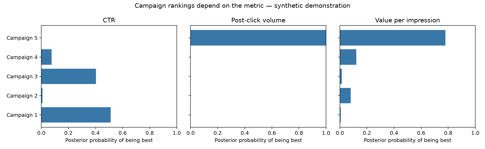

# Bayesian Campaign Performance Analysis
**Michele Chen | UCLA Anderson MSBA**

Which advertising campaign performs best—and how certain are we?

This portfolio adaptation of my Customer Analytics coursework compares five campaigns using click-through rate (CTR), post-click volume, and expected value per impression. It demonstrates Python, Bayesian inference, Monte Carlo simulation, and business metric interpretation.

## Results at a glance


A campaign can have a low probability of leading on CTR yet a high probability of leading on value per impression. Clicks alone do not capture downstream value. Probability of being best also differs from ranking observed averages: uncertainty matters.

**All published inputs and results are synthetic.** The original coursework used separate course-provided datasets. Those spreadsheets, assignment prompts, and submission PDFs are not distributed here. Public results will not reproduce the numerical results in the original submission.

## Method
1. Estimate each campaign's CTR using a beta-binomial model with a Beta(1,1) prior.
2. Draw post-click mean volume from a Student-t distribution centered on the sample mean, with sample standard error and n−1 degrees of freedom.
3. Generate 100,000 draws per campaign with a fixed random seed.
4. Multiply CTR and conditional mean post-click volume draws to estimate value per impression.
5. Report posterior means, 95% equal-tail credible intervals, and probability each campaign is best.

The Student-t model is the normal-data, unknown-variance reference-prior posterior for a mean. In this demonstration, individual volumes are positive and skewed, so this is a working approximation rather than a perfectly specified likelihood. The model assumes independent campaign samples and independent CTR/conditional-volume posterior draws. Real applications should assess dependence, outliers, drift, prior sensitivity, and alternative positive-valued models. Negative draws are not silently clipped.

## Business interpretation
- Choose a metric aligned with the decision: engagement versus downstream value.
- Probability of being best is not the same as expected profit or expected regret.
- Volume here is an arbitrary unit, not revenue, profit, conversion rate, or customer lifetime value.
- Spend, margin, capacity, and risk tolerance would be needed before recommending a budget allocation.
- This is an observational/synthetic campaign comparison, not a deployed randomized A/B test or evidence of causal lift.

## Run
Python 3.10+:
```sh
python -m venv .venv
source .venv/bin/activate
pip install -r requirements.txt
python analyze.py
```
Generated artifacts are in `results/`: input summaries, posterior statistics, and the comparison figure. The script checks finite results and that winner probabilities sum to one. Use `analysis.ipynb` for a notebook walkthrough.

## Project provenance
Based on my completed UCLA Customer Analytics analysis. The public version adds deterministic synthetic data, reusable code, plots, validation checks, and documentation with AI-assisted editing. The original submission also disclosed AI assistance for checking logic and improving explanations. No production impact is claimed.
